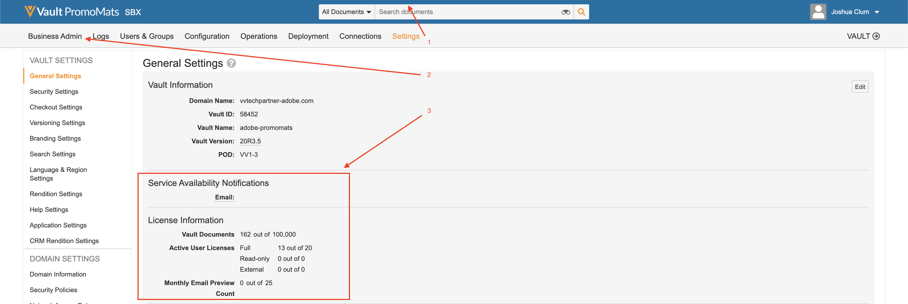

# Best practices, Guardrails, and Notices

## Versions

This integration requires the following minimum software versions:

* Adobe Experience Manager, 6.5.5+
* Veeva Vault PromoMats, 20R3.2+

## Data Privacy

This integration is designed to transfer content between Adobe Experience Manager and Veeva Vault PromoMats. As a data controller, your company is responsible for complying with any privacy laws and regulations applicable to your collection and use of data.

## Content Sync Frequency

AEM content and metadata is synced from AEM to VVPN when the integration workflow has been triggered. This can be done automatically or manually. VVPM Metadata is synced from VVPM to AEM. This can be done automatically through a scheduler or manually through a button click. 

## Integration Limitations and Best Practices and Guardrails

Consider the following limitations when using this integration:

* Only the following datatypes are supported when syncing metadata: "Text" and "Multiline Text".
* While the integration supports AEM modular content (Content Fragments and Experience Fragments), it does not support VVPM modular content.
* VVPM linked documents are not supported. 
* Syncing VVPM visual annotations from VVPM to AEM are not supported.
* The integration does not import content from VVPM to AEM.
* Metadata validation is not supported.
* The number of documents are limited based on the Veeva license. See [License Limitations](#veeva-license-limitations).
* The number of API calls are limited based on the Veeva license. For more information see [API Limitations](https://developer.veevavault.com/docs/#what-are-rate-limits). See [License Limitations](#veeva-license-limitations).

## Veeva License Limitations 

You can monitor your instance limits by navigating to the VVPM general settings.

