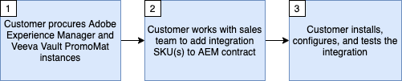

# Get Started with Veeva Vault PromoMats and Adobe Experience Manager integration

This integration will manage your content, enforcing rights and compliance while also leveraging first in class experience delivery.  

This integration requires the following minimum software versions:

* Adobe Experience Manager, 6.5.5+
* Veeva Vault PromoMats, 20R3.2+

>[!IMPORTANT]
>
>This capability is not available out of the box as part of the product. The implementation requires Adobe Consulting maintenance contract. Please reach out to your Adobe representative to find out more.
>

## Principles and Features

This integration is designed to support three main use cases:

1. Content Authoring - Allow agency users and marketers to create new or edit existing digital content in Adobe Experience Manager (AEM) using compliant digital assets approved and stored in Veeva Vault PromoMats (VVPM).

2. Content Approval - When new content has been created or existing content has been edited in AEM, the content must be approved for use in VVPM supporting the Medical, Legal, Regulatory (MLR) Approval process for Life Sciences.

3. Content Management - Provide visibility of asset utilization by establishing relationships in PromoMats between digital tactics (e.g. email, presentations, websites) and their elements (e.g. logos, photography, graphics) created in AEM.

The benefits include:

* Maintaining a single source of truth for assets and content without duplication across digital repositories 
* Leveraging both Veeva Vault for rights and compliance management and AEM for best in class and complete content management.

>[!IMPORTANT]
>
>This integration currently considers AEM as the source of truth for content synchronization.  
>

## Getting the Integration

In order to provision this integration, you will need to follow the steps below.

Please follow the flowchart and flowchart details below to request and configure the integration.

Flowchart Details (maps to steps above):

* **Step 1** - It is assumed that you already have, or are in the process of procuring, a license for Veeva Vault PromoMats and for Adobe Experience Manager.
* **Step 2** - A new sales order (SO) that outlines a maintenance agreement with Adobe Consulting will need to be signed in order to take advantage of the integration.
* **Step 3** - Install, activate, and configure the integration package.

## Support

The follow describes how to contact and log an issue with the support team.

### Requesting Integration or Adobe Experience Manager Support

Support tickets can be logged with Adobe Customer Care. Your Adobe Experience Cloud administrator will need to log on to [Adobe Admin Console](https://adminconsole.adobe.com/), click on the support tab, and create a case. For any issues with integration, make sure to include the following information:

* **Process Title**: `AEM - Veeva Vault Integration`
* **Process Owner**: `Data Engineering`
* **Description**: `Description of the issue`
* **Point of Contact**: `The email address(es) for relavant AEM point of contacts for your organization.` 
* **AEM Instance URL**: `Place the Adobe Experience Manager instance url here.`
* **Veeva Instance URL**: `Place the Veeva Vault PromoMats instance url here.`
* **Customer ID**: `Provide the Customer ID included in the on-boarding email sent to your team. You can just put your company name here if the ID is not available`

### Requesting Veeva Vault PromoMats Support

Sometimes, the issue being experienced is a problem with the operation of the Veeva Vault PromoMats instance. If that is the case, your Veeva Vault PromoMats administrator might be directed to create a support ticket with [Veeva Support](http://support.veeva.com/). The status of the Veeva instance can be viewed by navigating to [Veeva Trust](http://trust.veeva.com/).
