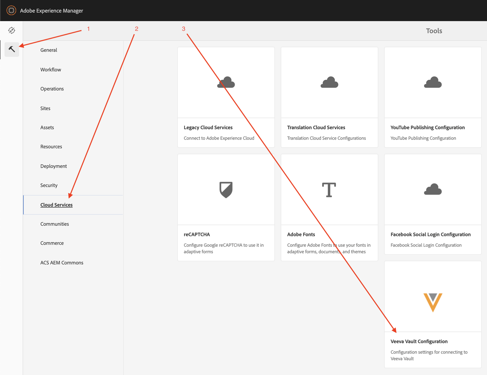
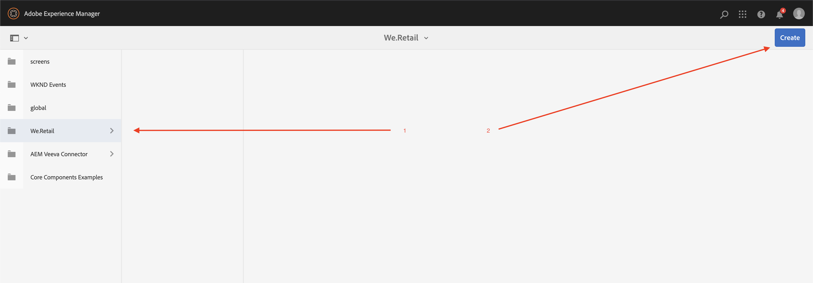
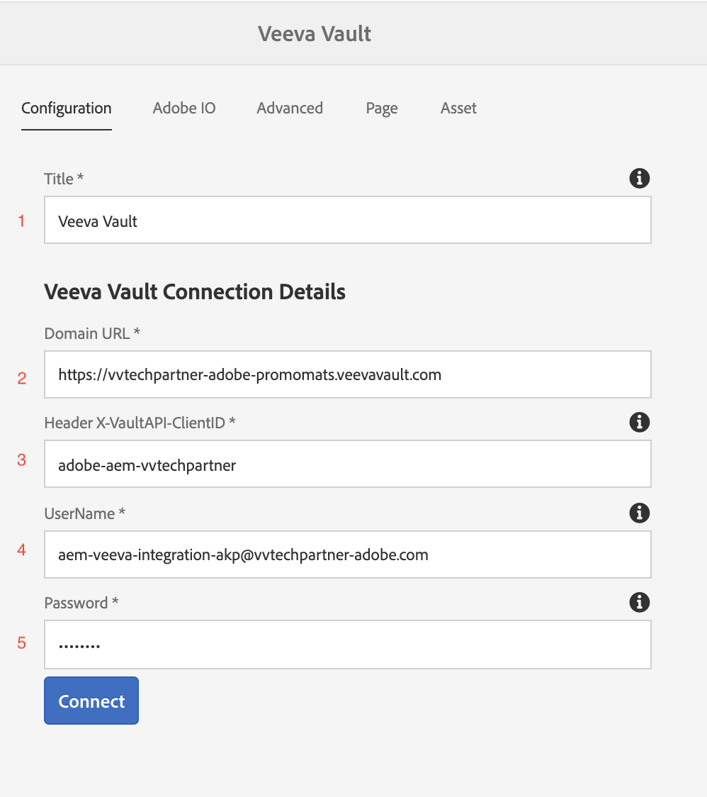
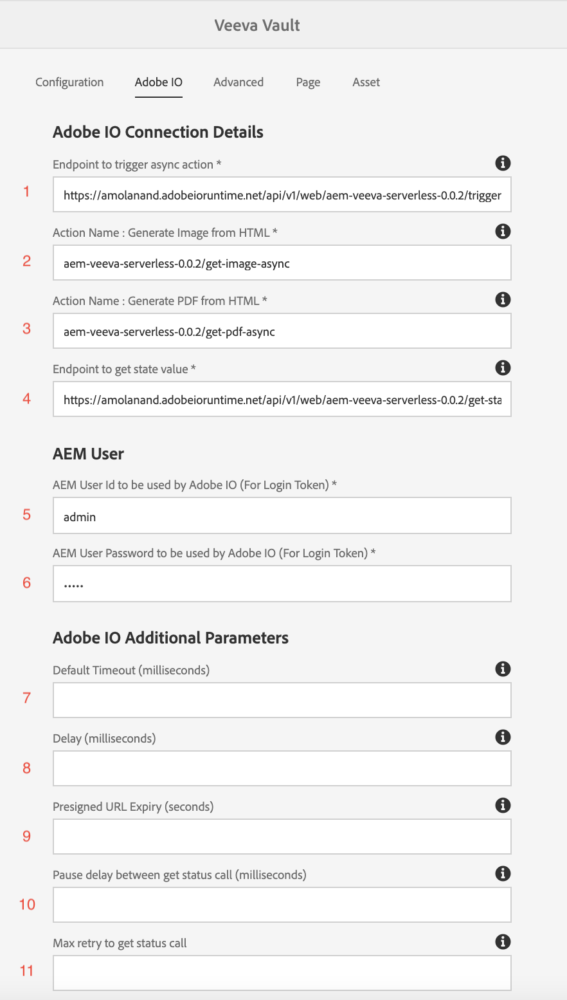
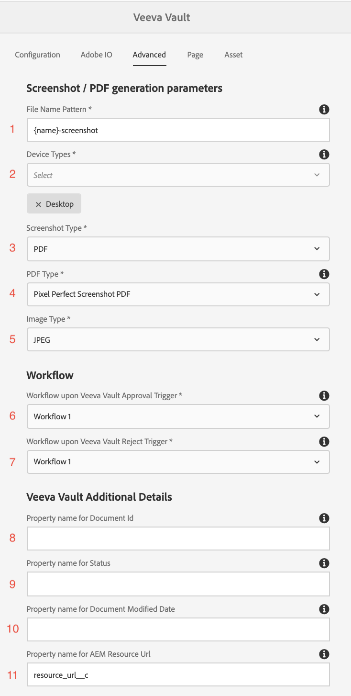
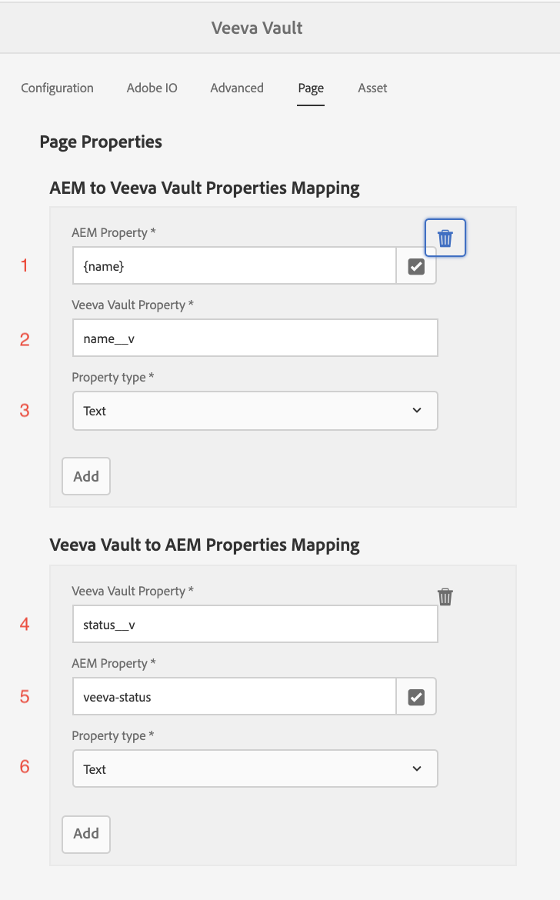
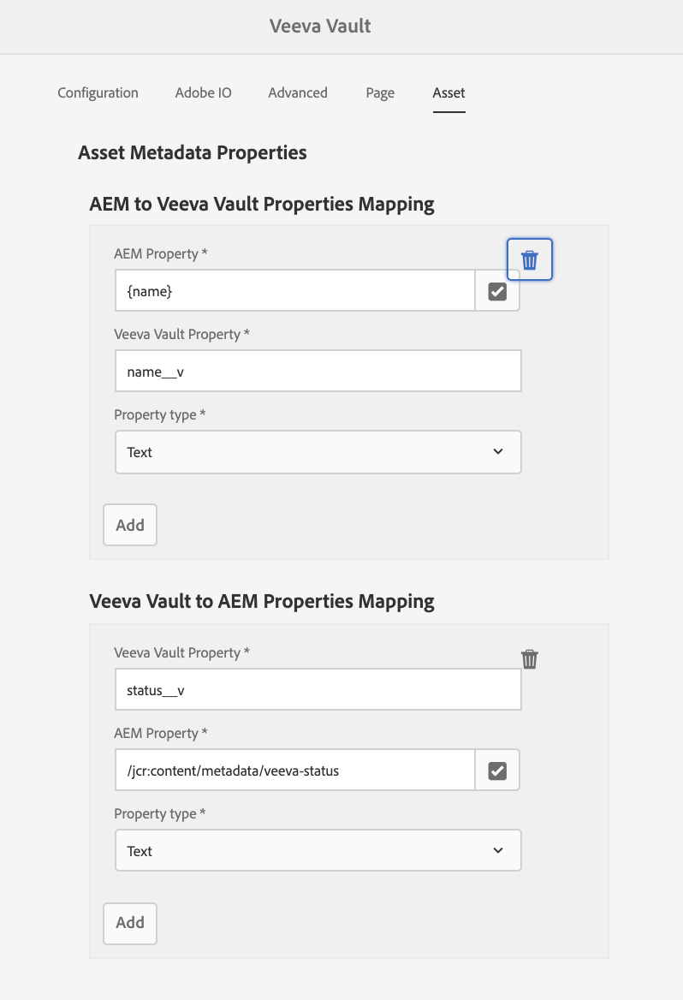
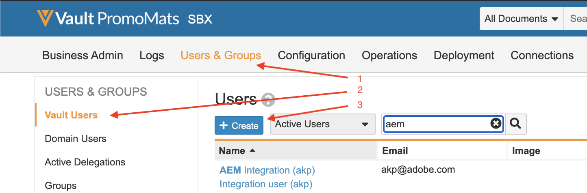
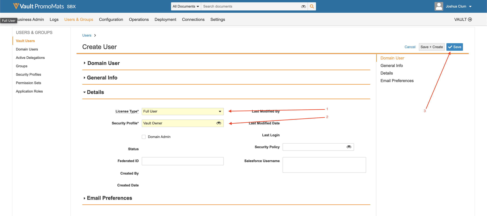

# Integration Usage

## Walkthrough

The following video walk-through describes using the connector:

>[!VIDEO](https://video.tv.adobe.com/v/332137/?quality=12&learn=on)

## Setup

This guide will walk you through getting the connector up and running.

>[!IMPORTANT]
>
>For each system, these steps need to be performed by an **administrator** for each system.
>
>Steps in this documentation will guide you through creating integrations/registrations that involve assigning permissions and/or admin access.  It is your responsibility to ensure these steps comply with your company policies before performing, and to perform them carefully.
>

### Install Integration Package

You will receive access to the integration AEM package. There are two options to install the integration: 

1. **Package Installation** - Straight forward and less involved.
2. **POM Installation** - More advanced, but can be useful when using AEM Cloud Manager and upgrading the integration.

#### Package Installation

To install the package, download it with the link provided. [Detailed instructions for installing an AEM package can be found by clicking here.](
https://experienceleague.adobe.com/docs/experience-manager-64/administering/contentmanagement/package-manager.html?#installing-packages) 

#### POM Installation

To include the connector in your POM, follow these steps. Replace your username and password with the ones received in the onboarding email.

1. Add the following to the `.cloudmanager/maven/settings.xml` file in your project or `~/.m2/settings.xml` on your computer. Replace `YOUR_USERNAME` with the username provided and `YOUR_PASSWORD` with the the password provided.

    >[!IMPORTANT]
    >
    >If using cloud manager, the secure approach is to follow the steps found here for [password protected Maven repositories](https://experienceleague.adobe.com/docs/experience-manager-cloud-service/onboarding/getting-access/create-application-project/setting-up-project.html?lang=en#password-protected-maven-repositories).
    >

    ```
    <settings>
        ...
        <servers>
            ...
            <server>
                <id>repo.ea.adobe.net</id>
                <username>YOUR_USERNAME</username>
                <password>YOUR_PASSWORD</password>
                <filePermissions>BucketOwnerFullControl</filePermissions>
                <configuration>
                  <wagonProvider>s3</wagonProvider>
                </configuration>
            </server>
            ...
        </servers>
        ...
    </settings>
    ```

2. Add the following to the project's `pom.xml` file:

    ```
    <project>
        ...
        <build>
            ...
            <extensions>
                ...
                <extension>
                    <groupId>com.allogy.maven.wagon</groupId>
                    <artifactId>maven-s3-wagon</artifactId>
                    <version>1.2.0</version>
                </extension>
                ...
            </extensions>
            ...
        </build>
        ...
        <repositories>
            ...
            <repository>
                <id>repo.ea.adobe.net</id>
                <url>s3://repo.ea.adobe.net/release</url>
                <releases>
                    <enabled>true</enabled>
                </releases>
            </repository>
            ...
        </repositories>
        ...
    </project>
    ```
   
3. Add the following to the project's `all/pom.xml` file. Replace `project.dependencies.dependency.version` with appropriate version and `project.build.plugins.plugin.configuration.embeddeds.embedded.target` with the correct path.

    ```
    <project>
        ...
        <build>
            ...
            <plugins>
                ...
                <plugin>
                    <groupId>org.apache.jackrabbit</groupId>
                    <artifactId>filevault-package-maven-plugin</artifactId>
                    ...
                    <configuration>
                        ...
                        <embeddeds>
                            ...
                            <embedded>
                                <groupId>com.adobe.acs.aemveeva</groupId>
                                <artifactId>aem-veeva-connector.all</artifactId>
                                <type>zip</type>
                                <target>/apps/APP_NAME-packages/application/install</target>
                            </embedded>
                            ...
                        </embeddeds>
                    </configuration>
                </plugin>
                ...
            </plugins>
            ...
        </build>
        ...
        <dependencies>
            ...
            <dependency>
                <groupId>com.adobe.acs.aemveeva</groupId>
                <artifactId>aem-veeva-connector.all</artifactId>
                <version>1.0.5</version>
                <type>zip</type>
            </dependency>            
            ...
        </dependencies>
        ...
    </project>
    ```

### Cloud Configuration

This integration is configured by creating a cloud configuration on folder the connector will be operating on. Follow these steps to create a cloud configuration:

1. Navigate to the Veeva cloud configuration.

    

2. Create a new Veeva cloud configuration on the appropriate folder and populate the as described in the next sections.

    

#### Configuration Tab

Fill out the following in the configuration tab:



1. Required. Title for Veeva Vault connector configuration. This can be an arbitrary value. (e.g. `Veeva Vault Configuration`)
2. Required. The domain url of the Veeva instance (e.g. `https://my-instance.veevavault.com/`)
3. Required. ClientID required to call Veeva Vault API. This can be an arbitrary value and is mostly used for debugging. (e.g. `adobe-aem-vvtechpartner`)
4. Required. Veeva Vault username. See [Veeva User Creation](#veeva-user-creation).
5. Required. Veeva Vault password. See [Veeva User Creation](#veeva-user-creation).

#### Adobe IO Tab

If the project needs to generate PDFs or images for pages, this tab is required. Fill out the following in the adobe io tab:



1. Required. The Adobe IO endpoint for creating PDF Images. (e.g. `https://my-namespace.adobeioruntime.net/api/v1/web/aem-veeva-serverless-0.0.2/trigger-action.json`)
2. Required. The action name for page image generation. This value must be `aem-veeva-serverless-0.0.2/get-image-async`.
3. Required. The action name for html image generation. This value must be `aem-veeva-serverless-0.0.2/get-pdf-async`.
4. Required. The Adobe IO endpoint to get the state of the generation.(e.g. `https://my-namespace.adobeioruntime.net/api/v1/web/aem-veeva-serverless-0.0.2/get-state-value`)
5. Required. AEM username to be used by Adobe IO. See [AEM User Creation](#aem-user-creation).
6. Required. AEM password to be used by Adobe IO. See [AEM User Creation](#aem-user-creation).
7. Optional. Default timeout is to let the page respond until a specified time after which AIO service stops trying to get a response. Default value is `30000`.
8. Optional. Delay is after page has responded with 200 to delay for all the images to render before taking a screenshot. Default value is `2000`.
9. Optional. Screenshot/PDF generated URL will be expired after configured value in seconds.
10. Optional. Adobe IO screenshot/PDF generation service is async. AEM service calls AIO status endpoint to get screenshot/PDF. This property will decide in milliseconds the pause between in each status call. Default value is `10000`.
11. Optional. Maximum retry count for status call to Adobe IO for getting screenshot/PDF. Default value is `10`.

#### Advanced Tab

Fill out the following in the advanced tab:



1. Required for PDF/image generation. The filename pattern used when creating PDFs/images. `{name}` can be templated. (e.g. `{name}-screenshot`)
2. Required for PDF/image generation. The device types for which page screenshots are required. Valid types include `Desktop`, `Tab (iPad)`, and `Mobile (iPhone X)`.
3. Required for PDF/image generation. Screenshot type to create. Either `PDF` or `Image`.
4. Required for PDF/image generation. The PDF type to generate. Either `Print CSS Based PDF` or `Pixel Perfect Screenshot PDF`.
5. Required for PDF/image generation. The Image type to generate. Either `PNG` or `JPEG`.
6. Required. Workflow to run once Veeva Vault Approval trigger has come through.
7. Required. Workflow to run once Veeva Vault Reject trigger has come through.
8. Optional. Property name for Document Id in Veeva Vault. Default value is `id`.
9. Optional. Property name for Status in Veeva Vault. Default value is `status__v`.
10. Optional. Property name for Document Modified Date. Default value is `version_modified_date__v`.
11. Optional. Property name for document resource url. Default value will be `external_id__v`. If this field is already used, then create a different field in Veeva and populate the field name here.

#### Page Tab

If syncing pages, fill out the following in the page tab:



1. Required. Map a property from AEM to Veeva.
    a. AEM property name. Selectable from AEM properties. (e.g. `jcr:title`)
    b. Veeva property name entered exactly at is exists in Veeva. (e.g. `name__v`)  
    c. Property type. Either `Text` or `Multiline Text`.

2. Required. Map a property from Veeva to AEM. **NOTE! The mapping of `status__v` to a representative AEM property must exist.**
    a. Veeva property name entered exactly at is exists in Veeva. (e.g. `name__v`)
    b. AEM property name. Selectable from AEM properties. (e.g. `jcr:title`)
    c. Property type. Either `Text` or `Multiline Text`.
    

#### Asset Tab

If syncing assets, fill out the following in the asset tab:



1. Required. Map a property from AEM to Veeva.
    a. AEM property name. Selectable from AEM properties. (e.g. `/jcr:content/metadata/jcr:title`)
    b. Veeva property name entered exactly at is exists in Veeva. (e.g. `name__v`)
    c. Property type. Either `Text` or `Multiline Text`.

2. Required. Map a property from Veeva to AEM. **NOTE! The mapping of `status__v` to a representative AEM property must exist.**
    a. Veeva property name entered exactly at is exists in Veeva. (e.g. `name__v`)
    b. AEM property name. Selectable from AEM properties. (e.g. `/jcr:content/metadata/jcr:title`)
    c. Property type. Either `Text` or `Multiline Text`.

### Additional Setup

#### AEM User Creation

During PDF/Image generation, an AEM user needs to be created in order to get pages from AEM. Create and give read only permissions to a user by following these links:

If using AEM 6.5.5+:

* [Creating a user in AEM](https://experienceleague.adobe.com/docs/experience-manager-65/forms/administrator-help/setup-organize-users/adding-configuring-users.html?#create-a-user)
* [Adding permissions to a user in AEM](https://experienceleague.adobe.com/docs/experience-manager-65/administering/security/security.html?#permissions-in-aem)
    
If using AEM Cloud Services:

* [Managing Users with AEM Cloud Services](https://experienceleague.adobe.com/docs/experience-manager-learn/cloud-service/accessing/aem-users-groups-and-permissions.html?#accessing)

>[!IMPORTANT]
>
> These actions must be performed as an administrator for each system.
> You must comply with your organizations security standards when creating users and setting permissions.
>

#### Veeva User Creation

In order to use this integration, a user needs to be created in Veeva Vault. To create a user, follow these steps:

1. Navigate to Admin -> Users and Groups -> Vault users -> Create
    
    

2. Fill out the required blacks. The simplest setup is to set the `License Type` to `Full User` and the `Security Profile` to `Vault Owner`. Save when complete.

    
    
The following permissions are required for the specific Veeva document types that are being used:
 
* Create/Read documents
* Create/Read versions
* Create/Update metadata
* Create/Update renditions

>[!IMPORTANT]
>
> These actions must be performed as an administrator for each system.
> You must comply with your organizations security standards when creating users and setting permissions. 
>
